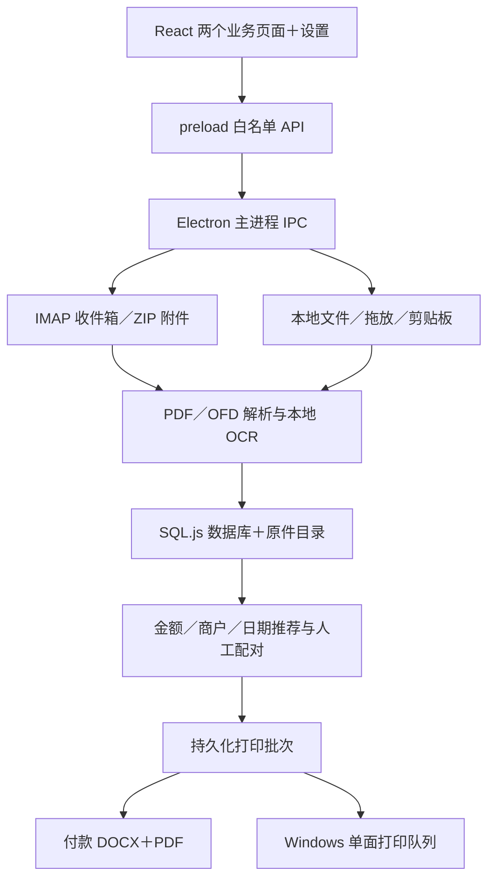
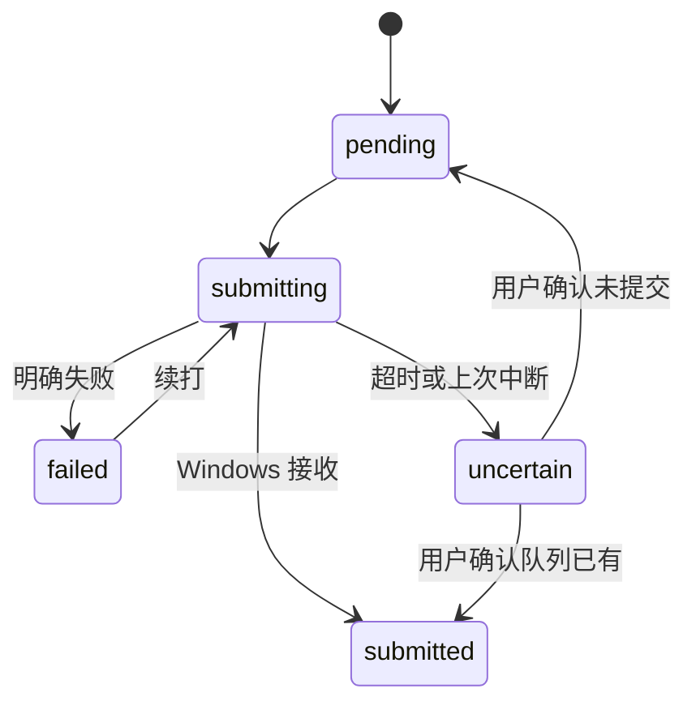

# 架构说明

[开发指南](DEVELOPMENT.md) · [发布指南](RELEASING.md)

## 运行结构

渲染进程关闭 Node 集成，启用 context isolation 和 sandbox；通过 preload 暴露的 API 访问主进程服务。应用窗口阻止非预期导航和新窗口。业务数据不需要经过远端服务。

## 目录与职责

| 位置 | 职责 |
| --- | --- |
| `electron/main.js` | 资料位置、窗口、启动识别、邮箱定时器和退出保存 |
| `electron/preload.js`／`electron/ipc.js` | API 暴露、输入校验、业务服务调度和进度事件 |
| `electron/store/` | SQL.js 持久化、设置、私人账号、目录定位和迁移 |
| `electron/services/mail/` | IMAP UID／UIDVALIDITY、日期范围、规则版本、附件展开 |
| `electron/services/documents/` | 多入口导入、PDF 正文与预览、OFD 模板坐标、字段解析 |
| `electron/services/ocr/` | OCR 队列、本地 ONNX 模型、长截图分段与收支核算 |
| `electron/services/watcher/` | 可选接收目录监听、图片去重和用途 |
| `electron/services/materials/`、`match/` | 材料修正、配对约束和推荐 |
| `electron/services/word/`、`print/` | 横向排版、打印 PDF、提交及续打 |
| `electron/services/reports/`、`ledger/`、`archive/` | 历史报销数据兼容和既有业务能力，当前主界面不要求创建报销单 |
| `renderer/src/pages/` | 发票报销、日常开销、设置及共用核对面板 |
| `assets/brand/` | 原创 SVG、导出 PNG／ICO、分享图 |
| `build/` | 使用说明、许可文件、字体和可再分发运行库资源，不是可随意删除的历史编译目录 |
| `scripts/`／`tests/` | 构建、图标、说明生成、审计、清理和合成回归 |

## 数据模型

核心数据包括 `invoices`、`invoice_variants`、`screenshots`、`invoice_payments`、`mail_sync`、`print_batches`、`print_jobs` 和 `daily_expenses`。旧报销表保留以兼容历史数据。

私人账号不保存在业务数据库账号表中，邮箱和加密授权码由独立 JSON 管理；数据库保留账号编号与同步游标。OCR 原文、票号、原始文件名和文件路径仍是敏感业务信息。

SQL.js 在内存运行，通过事务和持久化封装写回 `db/app.db`。写入使用临时文件及替换，避免直接暴露半写入内容；这不等于整个资料库有文件系统事务或多用户并发能力。

## 邮箱与解析

邮件按服务器接收日期筛选，使用 UID 与 UIDVALIDITY 增量处理。日期或接收规则版本变化时补扫，材料指纹负责避免重复入库。

ZIP 仅提取支持的材料，限制嵌套、数量和展开大小。PDF 先读正文，必要时对渲染页 OCR；OFD 文字按模板和位置重组。高铁票价、航空合计、填开日期和购买／销售方分别处理。

PDF/OFD 归并依赖票据身份，原件保留。重新识别通过分析版本控制，并尊重 `manual_fields`。

## 打印状态

仅发票模式不要求配对或金额识别；完整模式为每张发票对应一张付款截图，再生成一份合并文档。任务保存材料快照指纹，待打印文件变化时需要重新生成批次。

“已提交”不代表打印机实际完成；系统队列、驱动和硬件状态不由数据库推断。

## 边界

当前面向单机个人使用，不提供服务器、多用户访问控制、企业审批或云同步。自动化检查只覆盖已纳入的样本和流程，新平台、新票据格式及真实设备仍需单独验收。
