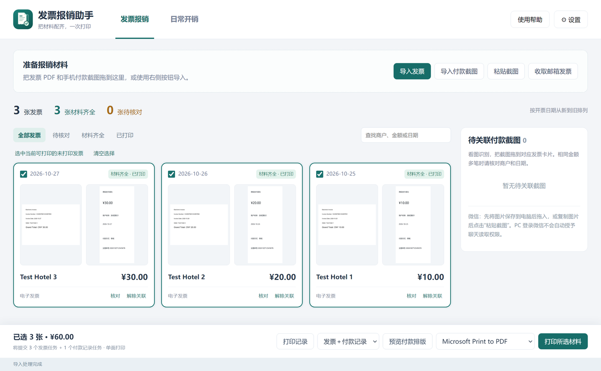
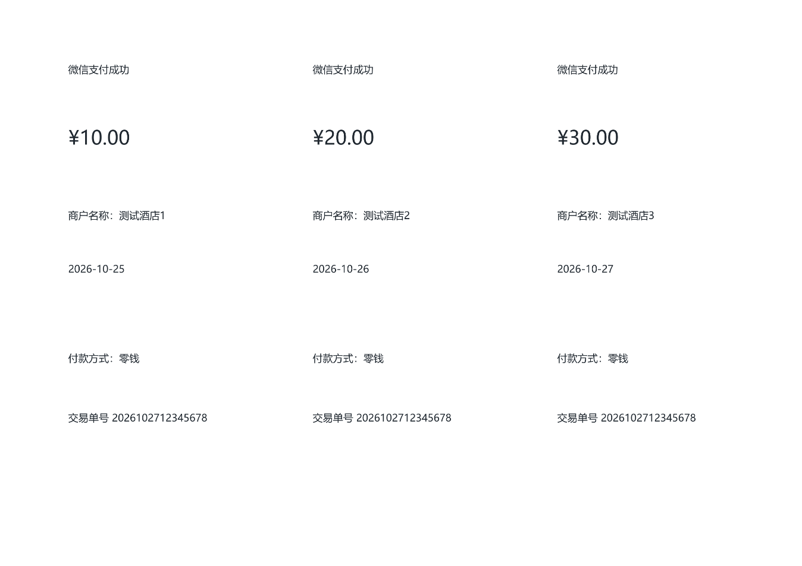
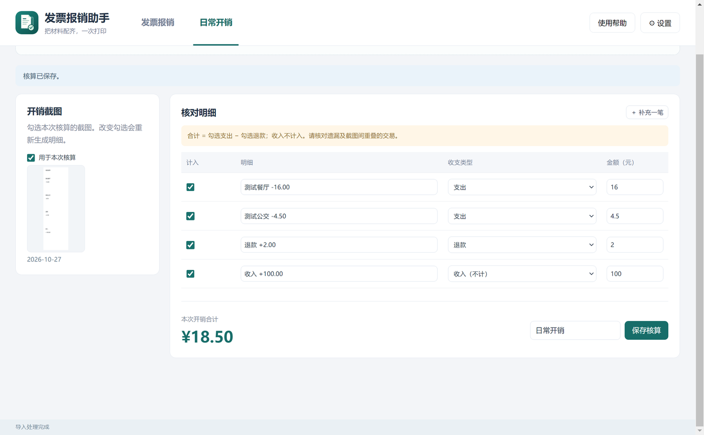

# 使用手册

[返回项目首页](../README.md) · [常见问题](FAQ.md) · [资料与隐私](PRIVACY.md)

本手册适用于当前 Windows x64 便携版。示例界面和文档图片使用合成材料，不对应真实报销记录。

## 1. 首次启动

从仓库 Releases 获取便携 EXE，将其放在可写目录后双击。无需安装。首次解压启动可能需要稍等片刻。

首次默认在 EXE 同级创建“报销资料”；设置中可以迁移到其他空目录。若默认位置无法写入，软件会提示选择目录。邮箱收取是可选项，只用本地导入也能完成报销材料打印。

已有用户升级时，将新版 EXE 放回原 EXE 所在目录，保留 `InvoiceAssistant.private.json` 和原资料目录，即可继续使用现有邮箱、日期设置及材料。

## 2. 先认识两个选项卡

| 位置 | 用来做什么 |
| --- | --- |
| 发票报销 | 发票原件＋实际付款截图的整理、核对、关联、打印 |
| 日常开销 | 日常账单或长截图的交易核算 |
| 设置 | 邮箱、收取日期、自动收取、付款记录排版、资料目录迁移 |
| 使用帮助 | 打开随软件附带的本手册 |

## 3. 导入发票

可点击“导入发票”，也可将 PDF、OFD 或 ZIP 拖入“发票报销”页面。ZIP 内的 PDF/OFD 会被提取；普通文本等无关文件不作为发票导入。

- 同内容文件再次导入会按指纹去重。
- 识别到相同发票号码的 PDF/OFD 会归为一张，保留原件，优先使用 PDF 预览和打印。
- 用车行程明细等辅助附件不额外算作一张发票。
- 只有 OFD 时可保留并解析文字，需要补充同票 PDF 后才能预览和批量打印。

发票卡片按开票日期从新到旧排列；缺少日期时使用接收／导入时间辅助排序。可以搜索商户、金额、日期或发票号码。

## 4. 配置邮箱和收取日期

打开“设置”，在邮箱区域填写：

| 字段 | 填写方式 |
| --- | --- |
| 显示名称 | 便于自己识别，如“报销邮箱” |
| 邮箱地址 | 实际收取发票的邮箱地址 |
| IMAP 服务器 | 按邮箱服务商的官方客户端说明填写 |
| 端口 | 默认 993，使用加密 IMAP 连接 |
| 授权码／密码 | 按服务商要求使用客户端授权码或允许的凭据 |

许多邮箱需要先在网页版邮箱中启用 IMAP，再生成独立的客户端授权码。具体入口与规则以服务商当前官方说明为准。需要交互式网页登录授权或额外企业认证的账号，当前版本未必适用。

保存后点击“收取发票”或返回主界面点击“收取邮箱发票”。工具只扫描 **INBOX 收件箱**，不遍历其他邮件文件夹，也不自动登录邮件正文中的发票下载网站。

### 日期范围

- 首次默认从第一次启动当日开始，结束日期留空，表示之后持续收取。
- 筛选依据是**邮件收到的日期**，包含起止当天，不是乘车日、开票日或截图日期。
- 想收取更早的发票：把开始日期改早，保存后再点击收取。
- 改变范围或接收规则升级时会补扫相应范围，已导入材料继续去重。
- 开启自动收取后，启动时检查一次，运行期间每 5 分钟检查；退出软件后停止。

邮箱存在邮件但列表没出现时，按[常见问题](FAQ.md)中的顺序排查，不要直接删除配置或数据库。

## 5. 导入手机实际付款截图

这里需要的是**实际付款记录**，例如微信、支付宝或银行卡交易详情页。常见格式包括 PNG、JPG/JPEG、WebP、BMP 和 GIF。

| 操作 | 结果 |
| --- | --- |
| 点击“导入付款截图” | 批量导入电脑里的图片 |
| 复制图片后点“粘贴截图” | 从剪贴板导入图片 |
| 拖入页面空白处或右侧截图区 | 导入待关联截图 |
| 单张图片拖到发票卡片 | 导入并尝试关联此发票 |
| 多张图片拖到发票卡片 | 导入后展示候选，供用户选择 |
| 将右侧已有截图拖到卡片 | 保存该截图与该发票的关联 |

### 从微信文件传输助手转入

手机发送原图到文件传输助手后，在 PC 微信将原图保存到电脑，再拖入工具；也可以在 PC 微信复制图片后使用“粘贴截图”。

PC 登录微信不会自动授予本工具聊天读取权限。本工具不扫描、解密微信数据库。微信拖拽对象若没有暴露可读取的文件内容，请使用保存原图或复制粘贴。

可选的自动接收方式：把已保存图片放入资料目录的 `incoming/` 文件夹，运行中的软件会监听并导入，默认作为付款截图。

## 6. 核对并关联

点击发票或截图预览，打开核对面板；可修正金额、日期、商户、票号等字段，并打开原件或所在文件夹。截图用途选错时，可在核对面板改为“发票付款截图”或“日常开销账单”；已关联的截图先解除关联。

推荐依据金额、商户和日期。相同金额有多笔时，需要看图确认；“采纳高匹配推荐”后也请核对两侧图片。手动修正的字段会保留，后续自动识别不会直接覆盖。

一张付款截图最多关联一张发票。“解除关联”保留原文件，将截图放回待关联区。失败、已取消或全额退款的记录不能直接作为正常付款凭证。

## 7. 选择打印模式

先勾选发票，再在底部选择打印模式和打印机。打印前可以点击“预览付款排版”。

| 模式 | 条件 | 提交任务 |
| --- | --- | --- |
| 仅打印发票 | 有可读取的 PDF 即可；金额和付款截图不是前置条件 | N 个发票任务 |
| 发票＋付款记录 | 所选发票均已配对有效付款截图 | N 个发票任务＋1 个合并付款记录任务 |

任务统一使用选定打印机、单面、1 份。N+1 指任务数：三张发票加一份两页付款记录，仍是四个任务，但可能打印五张纸。多页原始 PDF 会全部打印。

### 付款 Word 和排版

付款 Word 为 A4 横向，设置可选每页 2 张或 3 张标准手机截图，保持比例，完整显示。软件同时生成相同纸张和缩放尺寸的 PDF 作为打印内容，因此自动打印不依赖 Word/WPS。

输出在资料目录 `export/<批次编号>/`，包含付款 Word 与打印 PDF。仅打印发票模式不会生成空的付款 Word。

日常开销长截图不进入此 Word；超过标准手机截图长宽比例的图片需要归入日常开销统计。

### 失败续打

打开“打印记录”查看每个任务：

- **已提交**：Windows 接收了请求，不等于纸张已成功打印。
- **失败／待提交**：可点击“续打未提交任务”，已成功提交的任务不会自动重打。
- **状态待确认**：超时或程序中断造成状态不确定。先看 Windows 打印队列和实际出纸，再选择“队列中已有”或“确认未提交”。

卡纸、缺纸、离线或驱动问题要先在 Windows 和打印机上处理。建议第一次用少量材料试打，确认页数、方向及单面设置。

## 8. 日常开销核算

在“日常开销”选项卡导入、拖入或粘贴账单／长截图，勾选本次使用的图片，逐项核对：

1. 金额是否正确，是否有漏项。
2. 收支类型是否为支出、退款或收入。
3. 是否重复截到了同一笔交易。
4. 是否计入本次核算。

合计为“勾选支出 − 勾选退款”，收入不计入。可手动补充一笔，然后填写核算名称并保存。在“已保存核算”查看历史结果。

改变截图勾选会重新生成明细，建议先选齐截图再修正明细。当前不自动判断不同长截图之间的重复交易。

## 9. 文件位置、备份、迁移与升级

在设置中可查看并打开资料目录。文件含义详见[隐私与资料管理](PRIVACY.md)。

- **备份**：退出软件后备份完整资料目录，同时保留 EXE 旁的定位文件。邮箱配置与 `.key` 必须一起备份。
- **迁移**：停止导入、收取与打印，在设置中选择新的空资料目录。软件校验复制、更新定位并重启，旧目录不会自动删除。
- **升级**：退出旧版，新 EXE 放回原目录，保留定位文件和原资料目录。确认新版能看到材料后，再删除旧 EXE。
- **分发**：只发送公开发布包、使用说明和许可证，不发送自己的定位文件或资料库。

## 10. 当前边界

仅支持 Windows 10/11 x64。OCR 与匹配需要核对；当前是一张发票对应一张付款截图。OFD 独立渲染、手机端、微信数据库读取、云同步及企业审批不在当前支持范围。

ZIP 导入和图片、PDF 都设有大小／页数限制；超过限制时请按界面提示拆分。遇到不支持的票据，先保存原件，使用脱敏或合成样本反馈。
